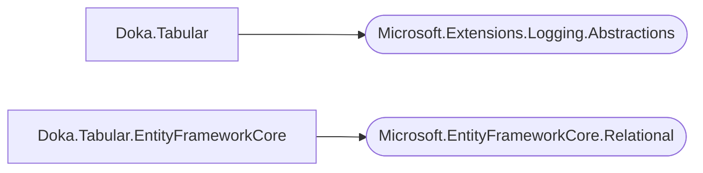
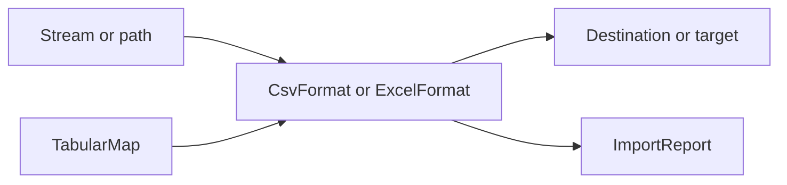
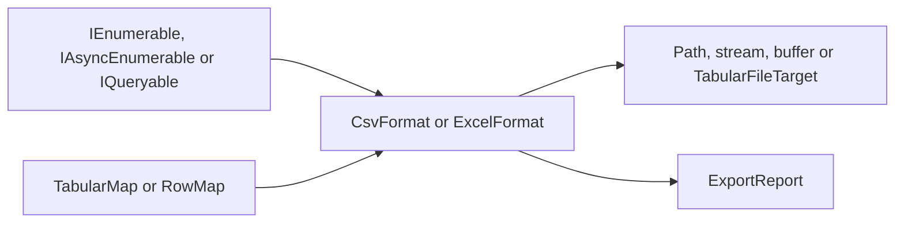
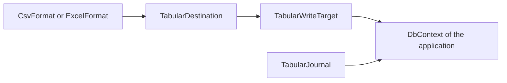
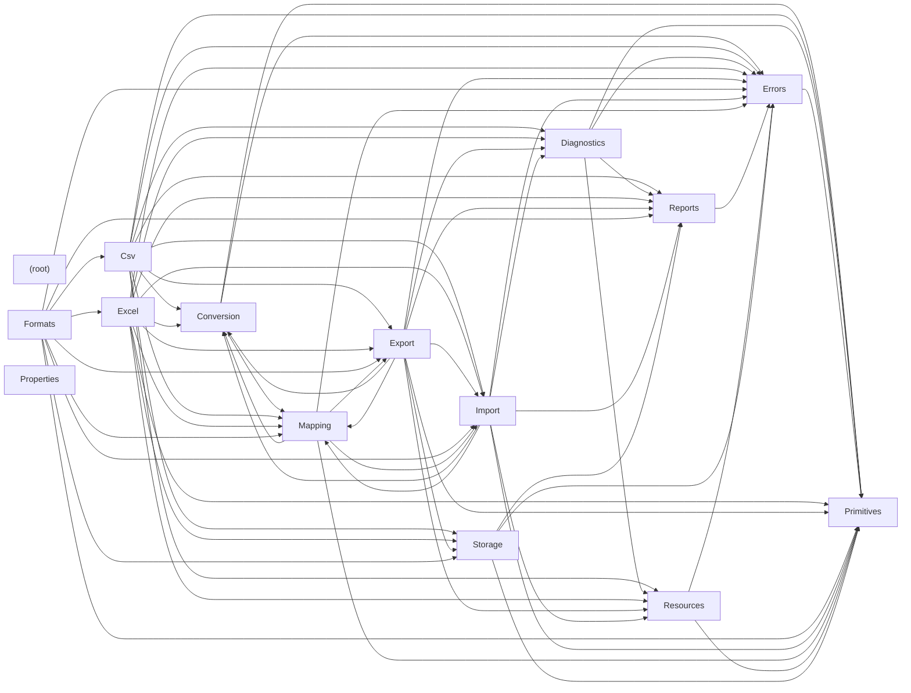
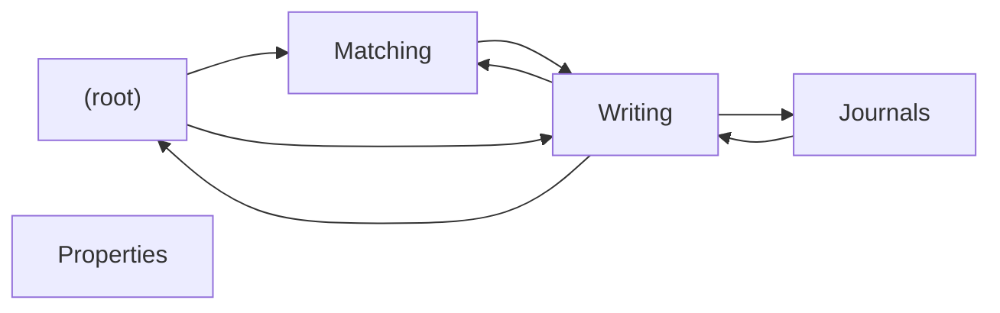
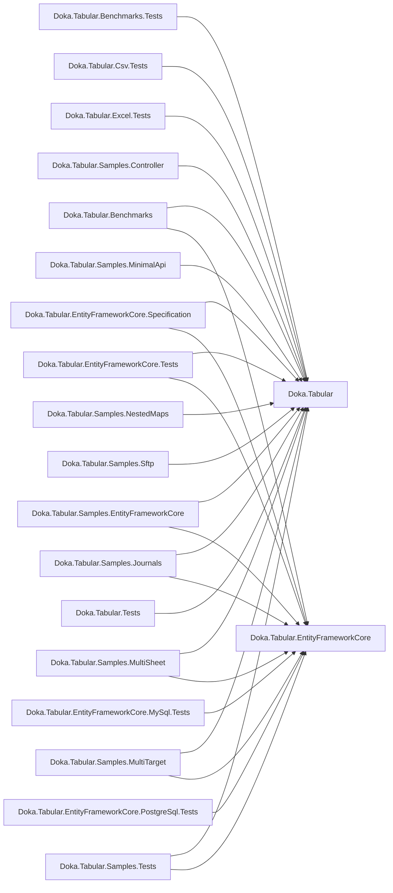

# Architecture

## System context

## Shipped packages

| Package | Responsibility |
| --- | --- |
| `Doka.Tabular` | maps, conversion, the CSV and Excel slices, the common entry point, reports, resources and diagnostics |
| `Doka.Tabular.EntityFrameworkCore` | EF Core write targets, transactions, and the import and export journals |

## Runtime composition

An application creates `CsvFormat` and `ExcelFormat` once with their options
and shares them; they are immutable and hold the defaults, limits, logger
factory and clock of every call. `TabularImport` and `TabularExport` are thin
entry points over these two instances. A `TabularMap` is built once with
`Build()` and is immutable, so many calls use it at the same time. Each call
owns its run: buffers, temporary files and the report live from the start to
the end of the call, and the library removes its own temporary files then.
`TabularDatabase` and `TabularJournal` are created over a context factory or a
passed context; a target they prepare describes the writes, and each import
opens its own write session with a context from the factory or the context
that the application passed in.

## Import flow

1. The application calls `ImportAsync` with the input, the map, and options
   or a destination.
2. The format checks the configuration of the call and the first bytes of the
   content before the first record.
3. The input is buffered within the limits of the call when a second read is
   needed.
4. The reader yields records; every field is converted and validated as the
   map describes, and errors are collected per record.
5. Valid records are created through their constructor or factory, and the
   strategy decides which records are taken over.
6. A destination receives the records that were taken over.
7. The call returns the report and removes its temporary files.

## Export flow

1. The application calls `ExportAsync` with the source, the map, and a path,
   stream, file target or no output for a buffered export.
2. The format checks columns, translations and layout before the first byte.
3. The source is enumerated, and each record is converted into cells.
4. A path receives a temporary file next to it that is renamed on success; a
   stream receives the bytes while the source is read; a buffered export
   returns its file only on full success; a file target hands the finished file
   to its store.
5. The call returns the report.

## Database write flow

1. Before the first write, the session checks pending changes of a passed
   context, the transaction, savepoint support, the execution strategy and the
   isolation level.
2. An import journal claims the hash of the input; a claimed file is skipped
   or rejected as the options decide.
3. Each row runs in a savepoint; its targets write in bind order, and a row
   error resets the row and its change-tracker state.
4. A strict import commits once; a partial import commits every
   `CommitGroupSize` valid rows. A failed commit is uncertain and ends the run.
5. The journal writes its commit evidence in the data transaction, so a later
   recovery can decide the outcome.

## Cross-cutting boundaries

### Security and privacy

Input files are untrusted; the
[security design](security/security-design.md) describes the trust
boundaries, threats and controls.

### Diagnostics

Every call logs its start and end and creates an activity when a listener is
registered, without values of the file, as the
[logging and tracing guide](guides/logging-and-tracing.md) describes.

### Trimming and deployment

Maps compile accessors at run time; the entry points carry the trimming and
AOT annotations of
[D-029](decisions/D-029-typed-pipeline-compiled-accessors-and-aot-marking.md),
and native AOT is a [limitation](limitations.md).

## Verification architecture

### Source responsibilities

#### Doka.Tabular

| Area | Uses |
| --- | --- |
| `(root)` | - |
| `Conversion` | `Errors`, `Mapping`, `Primitives` |
| `Csv` | `Conversion`, `Diagnostics`, `Errors`, `Export`, `Import`, `Mapping`, `Primitives`, `Reports`, `Resources`, `Storage` |
| `Diagnostics` | `Errors`, `Primitives`, `Reports`, `Resources` |
| `Errors` | `Primitives` |
| `Excel` | `Conversion`, `Diagnostics`, `Errors`, `Export`, `Import`, `Mapping`, `Primitives`, `Reports`, `Resources`, `Storage` |
| `Export` | `Conversion`, `Diagnostics`, `Errors`, `Import`, `Mapping`, `Primitives`, `Reports`, `Resources`, `Storage` |
| `Formats` | `Csv`, `Errors`, `Excel`, `Export`, `Import`, `Mapping`, `Primitives`, `Reports`, `Storage` |
| `Import` | `Conversion`, `Diagnostics`, `Errors`, `Mapping`, `Primitives`, `Reports`, `Resources` |
| `Mapping` | `Conversion`, `Errors`, `Export`, `Import`, `Primitives` |
| `Primitives` | - |
| `Properties` | - |
| `Reports` | `Errors` |
| `Resources` | `Errors`, `Primitives` |
| `Storage` | `Errors`, `Primitives`, `Reports` |

| Area | Decisions |
| --- | --- |
| `(root)` | [D-002](decisions/D-002-package-boundaries-format-slices-and-allowed-dependencies.md), [D-017](decisions/D-017-cancellation-tokens-and-optional-parameters.md) |
| `Conversion` | [D-006](decisions/D-006-value-conversion-and-field-options.md), [D-007](decisions/D-007-enums-and-flags.md), [D-008](decisions/D-008-date-and-time-rules.md), [D-029](decisions/D-029-typed-pipeline-compiled-accessors-and-aot-marking.md) |
| `Csv` | [D-002](decisions/D-002-package-boundaries-format-slices-and-allowed-dependencies.md), [D-014](decisions/D-014-format-selection-and-content-detection.md), [D-018](decisions/D-018-csv-dialect-and-content.md), [D-029](decisions/D-029-typed-pipeline-compiled-accessors-and-aot-marking.md) |
| `Diagnostics` | [D-027](decisions/D-027-logging-and-tracing.md) |
| `Errors` | [D-010](decisions/D-010-error-model-and-error-codes.md) |
| `Excel` | [D-002](decisions/D-002-package-boundaries-format-slices-and-allowed-dependencies.md), [D-014](decisions/D-014-format-selection-and-content-detection.md), [D-016](decisions/D-016-resource-contract-streams-and-temporary-files.md), [D-019](decisions/D-019-excel-import-formats-and-reading-rules.md), [D-020](decisions/D-020-excel-export-layout-and-cell-types.md), [D-021](decisions/D-021-escaped-strings-in-excel-cells.md), [D-022](decisions/D-022-multi-sheet-import-and-export.md), [D-029](decisions/D-029-typed-pipeline-compiled-accessors-and-aot-marking.md) |
| `Export` | [D-015](decisions/D-015-export-into-the-output-buffer.md), [D-028](decisions/D-028-json-conversion-of-own-value-types.md), [D-029](decisions/D-029-typed-pipeline-compiled-accessors-and-aot-marking.md) |
| `Formats` | [D-013](decisions/D-013-common-entry-point-and-per-call-options.md) |
| `Import` | [D-004](decisions/D-004-immutable-maps-dto-construction-column-binding-and-headers.md), [D-009](decisions/D-009-translation-of-headers-and-values.md), [D-011](decisions/D-011-validation-and-pre-checks.md), [D-029](decisions/D-029-typed-pipeline-compiled-accessors-and-aot-marking.md) |
| `Mapping` | [D-004](decisions/D-004-immutable-maps-dto-construction-column-binding-and-headers.md), [D-005](decisions/D-005-row-maps-nested-maps-and-composed-values.md), [D-006](decisions/D-006-value-conversion-and-field-options.md), [D-011](decisions/D-011-validation-and-pre-checks.md), [D-029](decisions/D-029-typed-pipeline-compiled-accessors-and-aot-marking.md) |
| `Primitives` | [D-028](decisions/D-028-json-conversion-of-own-value-types.md) |
| `Properties` | - |
| `Reports` | [D-012](decisions/D-012-import-and-export-reports.md) |
| `Resources` | [D-015](decisions/D-015-export-into-the-output-buffer.md), [D-016](decisions/D-016-resource-contract-streams-and-temporary-files.md) |
| `Storage` | [D-026](decisions/D-026-export-journal-and-stored-files.md) |

The slices `Csv` and `Excel` read and write their formats over the shared
pipeline of `Mapping`, `Conversion`, `Import` and `Export`; `Formats` holds the
common entry point above both slices.

#### Doka.Tabular.EntityFrameworkCore

| Area | Uses |
| --- | --- |
| `(root)` | `Matching`, `Writing` |
| `Journals` | `Writing` |
| `Matching` | `Writing` |
| `Properties` | - |
| `Writing` | `(root)`, `Journals`, `Matching` |

| Area | Decisions |
| --- | --- |
| `(root)` | [D-002](decisions/D-002-package-boundaries-format-slices-and-allowed-dependencies.md), [D-017](decisions/D-017-cancellation-tokens-and-optional-parameters.md), [D-023](decisions/D-023-ef-core-write-targets-insert-upsert-and-lookup.md) |
| `Journals` | [D-025](decisions/D-025-import-journal-and-duplicate-detection.md), [D-026](decisions/D-026-export-journal-and-stored-files.md) |
| `Matching` | [D-023](decisions/D-023-ef-core-write-targets-insert-upsert-and-lookup.md) |
| `Properties` | - |
| `Writing` | [D-023](decisions/D-023-ef-core-write-targets-insert-upsert-and-lookup.md), [D-024](decisions/D-024-ef-core-transactions-and-row-error-mapping.md) |

`Writing` holds the write session and the targets, `Matching` the key
matches, and `Journals` the import and export journals that run inside the
write session.

### Test responsibilities and fixture ownership

`tests/Shared` holds the fixtures that every test application compiles, and
`tests/Shared/Database` the image manifest reader and the MariaDB server that
the MySQL and PostgreSQL tests and the database samples use.
`Doka.Tabular.EntityFrameworkCore.Specification` owns the EF Core cases that
the SQLite, PostgreSQL and MySQL test projects run.
`tests/Doka.Tabular.Excel.Tests/Fixtures` owns the reference workbooks.

## Architectural invariants

1. `Csv` does not use `Excel`.
2. `Excel` does not use `Csv`.
3. `Conversion` does not use `Excel`.
4. `Csv` does not use `Formats`.
5. `Excel` does not use `Formats`.
6. `Doka.Tabular` references no EF Core package, so the core package stays
   usable without a database.

## Related documentation

- [D-002](decisions/D-002-package-boundaries-format-slices-and-allowed-dependencies.md):
  package boundaries and format slices.
- [D-013](decisions/D-013-common-entry-point-and-per-call-options.md): the
  common entry point.
- [D-016](decisions/D-016-resource-contract-streams-and-temporary-files.md):
  streams and temporary files.
- [D-023](decisions/D-023-ef-core-write-targets-insert-upsert-and-lookup.md)
  and [D-024](decisions/D-024-ef-core-transactions-and-row-error-mapping.md):
  EF Core targets and transactions.
- [D-025](decisions/D-025-import-journal-and-duplicate-detection.md) and
  [D-026](decisions/D-026-export-journal-and-stored-files.md): the journals.
- [Getting started](guides/getting-started.md) and the other
  [guides](README.md).
