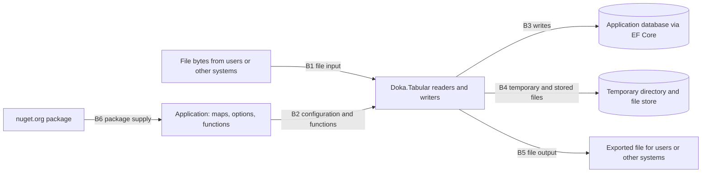

# Security design

## Security objectives

1. A file from an untrusted source cannot make Doka.Tabular resolve external
   resources, run code from the file, or use more memory, disk or time than
   the limits of the call allow.
2. A file Doka.Tabular writes contains the values of the application and no
   content that a spreadsheet program executes.
3. Reports and log events do not disclose the content of a file unless the
   application releases it per column.
4. An import changes the database of the application only as its strategy and
   targets describe, and an uncertain outcome is reported, never hidden.
5. A package on nuget.org is the package that the release workflow built from
   the signed tag.

## Assets

- The availability of the application process: memory, disk space of the
  temporary directory, and processing time.
- The database of the application that the EF Core targets and journals
  write.
- The values in imported and exported files, which can be personal or
  business data.
- The integrity of the published packages.

## Trust boundaries

- **B1 file input:** CSV text and workbook packages; every byte is untrusted.
- **B2 configuration and functions:** maps, options, rules, factories and
  storage adapters of the application; trusted, but their exceptions and
  results are checked.
- **B3 writes:** entities and journal rows that Doka.Tabular saves through the
  context of the application.
- **B4 temporary and stored files:** buffers spilled to the temporary
  directory and files handed to an `ITabularFileStore`.
- **B5 file output:** files the application hands to users or other systems.
- **B6 package supply:** the packages and their dependencies that the
  application restores.

## Threats and controls

### Exhaustion through a large or compressed input

**Threat.** A file, small on the wire, expands to gigabytes or holds fields of
millions of characters, so that the process runs out of memory or disk.

**Controls.** Workbook parts are counted while they are unpacked against
`MaxExpandedBytes`, 1 GiB by default; `MaxInputBytes`, `MaxFieldCharacters`
and `MaxTemporaryBytes` bound the input, a field and the temporary files of a
call; a reached limit ends the call with `tabular.resource.limitExceeded`. The
[resources and limits guide](../guides/resources-and-limits.md) lists every
limit.

**Residual risk.** Only `MaxExpandedBytes` has a default; the other limits are
unset until the application sets them.

### XML entity and external reference attacks

**Threat.** A workbook part declares a DTD with entity expansion or an
external entity, to exhaust memory or read local files.

**Controls.** Every XML read of a workbook prohibits DTD processing and has no
resolver for external references; a part with a DTD ends the import.
[D-002](../decisions/D-002-package-boundaries-format-slices-and-allowed-dependencies.md)
records the rule.

**Residual risk.** None known beyond the size of the XML, which the
expansion limit bounds.

### Executable content in a read workbook

**Threat.** An XLSM workbook carries macros, or formulas that compute other
values than the stored ones.

**Controls.** Doka.Tabular has no code that runs macros or computes formulas;
it reads the stored values only, and `RejectFormulas()` rejects every formula
cell of a column ([Excel guide](../guides/excel.md)).

**Residual risk.** A stored formula result is taken over as the value the
workbook claims; a column that must hold typed input uses `RejectFormulas()`.

### Formula injection in exported files

**Threat.** A value such as `=HYPERLINK(...)` in an exported file runs as a
formula when a user opens the file in a spreadsheet program.

**Controls.** The Excel writer writes text as text cells, never as formulas,
also when the text starts with `=`. CSV has no cell types: the CSV writer
writes every field unchanged, as RFC 4180 requires
([CSV guide](../guides/csv.md)).

**Residual risk.** A spreadsheet program can treat a CSV field that starts
with `=`, `+`, `-` or `@` as a formula; neutralizing such values is the task of
the application (see [Secure deployment requirements](#secure-deployment-requirements)).

### Disclosure of file content

**Threat.** Values of a file appear in error messages, logs or traces that
other people can read.

**Controls.** Error messages contain no source values; `SourceValue` is set
only for columns with `IncludeSourceValue()`. Log events and activity tags
carry no source values, headers, paths or messages
([D-010](../decisions/D-010-error-model-and-error-codes.md),
[D-027](../decisions/D-027-logging-and-tracing.md)).

**Residual risk.** Values the application itself logs, and columns it releases
with `IncludeSourceValue()`, are its responsibility.

### Unintended or repeated changes to the database

**Threat.** An import writes records twice, partially, or with an unknown
outcome that the application treats as success.

**Controls.** A strict import takes over nothing after one error; every row
runs in a savepoint; an uncertain commit ends the run with
`tabular.persistence.commitUnknown`; an import journal detects a file
imported twice and recovers the outcome from its commit evidence
([Entity Framework Core guide](../guides/entity-framework-core.md),
[journals guide](../guides/journals.md)).

**Residual risk.** Without an import journal, the application clarifies an
uncertain outcome itself.

### Tampered packages

**Threat.** A package on nuget.org differs from the reviewed source.

**Controls.** Releases come only from the SSH-signed tag of an admin on a
qualified commit, with build provenance and SBOM attestations, Trusted
Publishing and an immutable GitHub release
([release process](../release-process.md),
[release verification](release-verification.md)).

**Residual risk.** A compromised signing key or GitHub account of the
maintainer; the [publication runbook](../operations/release-publication.md#signing-key-compromised)
describes the response.

## Abuse cases

- A user uploads a workbook that expands to many gigabytes
  ([exhaustion](#exhaustion-through-a-large-or-compressed-input)).
- A workbook part declares an external entity that points to a local file
  ([XML attacks](#xml-entity-and-external-reference-attacks)).
- A user uploads an XLSM with macros and formulas whose stored results
  disguise the real values
  ([executable content](#executable-content-in-a-read-workbook)).
- A user enters `=HYPERLINK(...)` in a form; another user opens the CSV export
  in a spreadsheet program ([formula injection](#formula-injection-in-exported-files)).
- An attacker provokes conversion errors and reads the values of other rows in
  a shared log ([disclosure](#disclosure-of-file-content)).
- A file is uploaded twice under different names to book the same records
  twice ([repeated changes](#unintended-or-repeated-changes-to-the-database)).

## Assurance cases

### No external resources when reading a workbook

**Claim.** Reading a workbook never processes a DTD and never resolves an
external reference.

**Argument.** Every XML reader of the Excel slice is created with one shared
setting that prohibits DTD processing and has no resolver; a DTD ends the read
with an error before any entity is expanded.

**Evidence.** [ExcelXml.cs](../../src/Doka.Tabular/Excel/ExcelXml.cs) defines
the settings; `Dtd_InPackageXml_IsRejected` in
[ExcelReadTests.cs](../../tests/Doka.Tabular.Excel.Tests/ExcelReadTests.cs)
reads a package with a DTD.

**Assumptions.** The BCL `XmlReader` honors `DtdProcessing.Prohibit`.

### Bounded expansion of a workbook

**Claim.** The bytes unpacked from one workbook never exceed
`MaxExpandedBytes`.

**Argument.** Every part is read through a stream that counts the unpacked
bytes against one budget per call and fails as soon as the budget is
exceeded, before the bytes are processed further.

**Evidence.** [ExpansionBudget.cs](../../src/Doka.Tabular/Excel/ExpansionBudget.cs)
and [ExpansionCountingStream.cs](../../src/Doka.Tabular/Excel/ExpansionCountingStream.cs);
`ExpandedBytes_AreLimitedWhileUnpacking` in
[ExcelReadTests.cs](../../tests/Doka.Tabular.Excel.Tests/ExcelReadTests.cs).

**Assumptions.** The application keeps the default or sets a limit that its
process can afford.

### No formulas in exported workbooks

**Claim.** An Excel export writes no formula cell.

**Argument.** The writer has cell types for numbers, dates, booleans and text
only; text is always written as a string cell.

**Evidence.** [ExcelSheetWriter.cs](../../src/Doka.Tabular/Excel/ExcelSheetWriter.cs);
`TextCells_StayTextAlsoWhenTheyLookLikeFormulas` in
[ExcelExportTests.Limits.cs](../../tests/Doka.Tabular.Excel.Tests/ExcelExportTests.Limits.cs).

**Assumptions.** None.

### No source values in messages and logs

**Claim.** Error messages and log events contain no values of the file;
`SourceValue` is set only for released columns.

**Argument.** Messages are built from fixed texts and locations; the source
text is copied into an error only when its column was released with
`IncludeSourceValue()`, and log events carry identifiers, counters and status
only.

**Evidence.** `SourceValue_AppearsOnlyForReleasedColumns` in
[BehaviorTests.Errors.cs](../../tests/Doka.Tabular.Tests/BehaviorTests.Errors.cs);
`Logging_WritesStartAndCompletionWithTheOperationIdAndNoSourceValues` in
[BehaviorTests.Diagnostics.cs](../../tests/Doka.Tabular.Tests/BehaviorTests.Diagnostics.cs).

**Assumptions.** Functions of the application do not put source values into
their exception messages, which Doka.Tabular does not copy into errors either.

## Secure deployment requirements

- Set `MaxInputBytes`, `MaxFieldCharacters` and `MaxTemporaryBytes` for input
  from untrusted sources, because only `MaxExpandedBytes` has a default.
- Neutralize values that start with `=`, `+`, `-` or `@` before a CSV export
  that people open in a spreadsheet program, because CSV has no text type and
  the writer keeps values unchanged.
- Use `RejectFormulas()` for columns that must contain entered values, because
  a stored formula result is taken over as the workbook states it.
- Keep `TemporaryDirectory` on a volume that only the application can read,
  because spilled buffers hold the content of the file.
- Release columns with `IncludeSourceValue()` only where the reader of the
  report may see the value.
- Use an import journal where a repeated or uncertain import must be
  detected, because without it the application clarifies the outcome itself.
- Choose file names and paths of imports and exports in the application;
  Doka.Tabular writes to the path it receives.

| Limit | Default | Recommended for untrusted input |
| --- | --- | --- |
| `MaxExpandedBytes` (Excel) | 1 GiB | the largest workbook the process can hold in its temporary directory |
| `MaxInputBytes` | none | the largest file the application accepts |
| `MaxFieldCharacters` | none | the longest field the application stores |
| `MaxTemporaryBytes` | none | the free space the application reserves per call |
| `ImportBufferBytes` | 16 MiB | the default, or lower for many parallel calls |

## Review triggers

- A new file format or a new part of a workbook is read.
- A new limit is added, or a default limit changes.
- Doka.Tabular takes a new dependency.
- A new kind of target writes to a store of the application.
- A vulnerability is reported in the XML or ZIP handling of the BCL.
